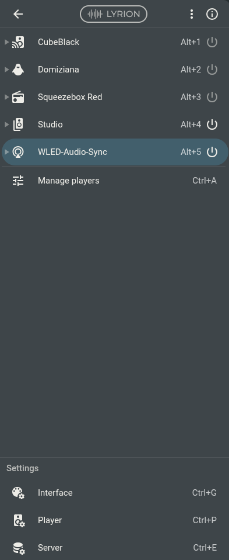
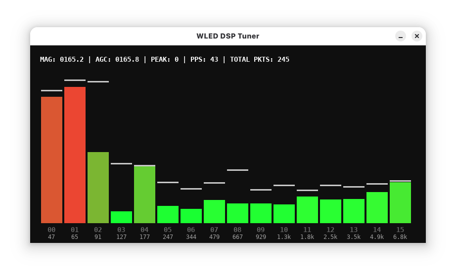

# WLED Audio Bridge (LMS)

A high-performance digital audio bridge that connects **Lyrion Music Server (LMS)** directly to **WLED** instances over UDP multicast for synchronized, sound-reactive LED lighting with zero acoustic latency.

Instead of relying on analog or I2S microphones wired to microcontrollers, which suffer from room reflections, background noise, and hardware gain clipping. This bridge taps directly into the master digital stream, executes real-time 16-band Fast Fourier Transform (FFT) DSP on the host CPU, and broadcasts native WLED AudioReactive V2 sync packets across your local network.

[](https://www.youtube.com/watch?v=Z9ulP79JX2k)
> 📺 **Demo Video:** [Watch the real-time audio-reactive demo on YouTube](https://www.youtube.com/watch?v=Z9ulP79JX2k)



> **⚠️ OS ARCHITECTURE WARNING**
> The primary, zero-latency architecture relies on the Linux kernel's ALSA loopback module (`snd-aloop`) to act as a flawless hardware metronome. A fallback pipeline is provided for macOS and Windows, but it is entirely software-paced and will suffer from buffer bloat and accumulating sync drift.

---

## How It Works

1. **Digital Audio Ingestion:** A headless Squeezelite instance connects to your LMS server as a dedicated virtual player (via auto-discovery or explicit IP), streaming uncompressed 44.1 kHz 16-bit PCM stereo audio. On Linux, it routes directly into a virtual ALSA loopback device (`snd-aloop`) to enforce absolute hardware pacing.
   
2. **2:1 Decimation & Sub-Bass Resolution:** To solve the standard FFT bin resolution bottleneck at 44.1 kHz without breaking LMS clock sync, the bridge ingests 1024-sample chunks and decimates the stream 2:1 down to 22.05 kHz (512 samples). This tightens frequency bin resolution to **43.06 Hz per bin**, allowing the DSP to isolate 40 Hz sub-bass rumbles from 80 Hz kick drums.

3. **Logarithmic Frequency Mapping (100 Hz – 6 kHz):** Samples are windowed with a pre-computed Hanning curve and partitioned into 16 logarithmically spaced frequency bins. The upper boundary is capped at 6 kHz to focus display resolution on the musical core (sub-bass, bass, mids, presence) instead of wasting precious LED bands on inaudible ultrasonic noise or cymbal splash.

4. **Treble Tilt (1/f Compensation):** Acoustic energy naturally rolls off at higher octaves. The bridge applies a gentle logarithmic power curve (`TILT_EXPONENT = 0.55`) across the 16 bands so high-frequency percussive elements register with punch without overpowering the kick drum.

5. **Asymmetric Auto Gain Control (AGC):**
   * **Instant Attack:** Instantly raises the tracking ceiling on heavy drops and drum transients to eliminate 8-bit clipping (255 whiteouts).
   * **Decay Ballistics (`DECAY_RATE = 0.88`):** Decays the envelope ceiling smoothly across frames, holding peaks long enough to preserve punch without pumping.
   * **Hard Clamping:** Clamps gain strictly between `GAIN_MIN` (500.0) and `GAIN_MAX` (1500.0) to prevent background noise amplification during quiet passages.

6. **Contrast Shaping & Baseline Offset:**
   * **Contrast Curve (`CONTRAST_EXPONENT = 0.8`):** Applies an exponential power curve to suppress background harmonics and emphasize transients.
   * **Baseline Offset (`BASELINE_OFFSET = 8.0`):** Adds a subtle resting floor to the 8-bit payload, preventing LED pixels from harsh on/off strobe transitions during playback.

7. **Metronome Hardware Pacing & Gap Detection:** On Linux, ALSA acts as a hardware master clock to maintain a strict ~43 FPS output rate matching WLED's native frame loop. An integrated gap detector resets the metronome if an empty pipe occurs during track changes or pauses, eliminating start-of-track lag.

8. **Multicast Broadcast:** Processed spectral frames are packed into the canonical 44-byte WLED AudioReactive V2 C-struct (`00002` header) and broadcast via UDP multicast (`239.0.0.1:11988`).

---

## Why Use This?

* **Zero Microphones:** Eliminates analog microphone wiring, noise floors, and GPIO contention on your ESP boards.
* **Master-Quality Signal:** Direct mathematical analysis of the pure digital stream without room reflections or acoustic distortion.
* **ESP8266 & ESP32 Compatible:** Offloads all floating-point math and FFT DSP to the host CPU, giving low-power ESP8266 boards full 16-band reactivity.
* **Network-Wide Synchronicity:** A single bridge instance broadcasts to an unlimited number of WLED matrices and strips in lockstep.
* **Multi-Room Audio Friendly:** Synchronize the virtual player with existing physical LMS zones for unified visuals throughout your network.

---

## Environment Variables & Tunables

Adjust these in your `docker-compose.yml` or shell environment:

| Variable | Default | Description |
| :--- | :--- | :--- |
| `LMS_IP` | *Empty (Auto)* | IP address of your LMS / Lyrion server. Leave empty for auto-discovery. |
| `PLAYER_NAME` | `WLED-Audio-Sync` | Virtual player name visible inside LMS. |
| `PLAYER_MAC` | `02:00:00:11:98:88` | Virtual MAC address assigned to Squeezelite. |
| `UDP_IP` | `239.0.0.1` | Target UDP IP. Defaults to standard WLED multicast. Set to a unicast IP for targeted diagnostic monitoring. |
| `UDP_PORT` | `11988` | Target UDP port for WLED AudioReactive sync. |
| `FREQ_MIN` | `100.0` | Lower frequency bound (Hz) for Band 00 (Sub-bass / Kick). |
| `FREQ_MAX` | `6000.0` | Upper frequency bound (Hz) for Band 15 (Presence / Treble). |
| `GAIN_MIN` | `500.0` | Minimum AGC gain multiplier (prevents blowout on heavily compressed audio). |
| `GAIN_MAX` | `1500.0` | Maximum AGC gain ceiling (prevents runaway gain on quiet tracks). |
| `TILT_EXPONENT` | `0.55` | Treble compensation exponent across the logarithmic center frequencies. |
| `DECAY_RATE` | `0.88` | AGC peak envelope decay multiplier per frame. |
| `CONTRAST_EXPONENT` | `0.8` | Exponential curve factor to separate beat transients from mid-level background music. |
| `BASELINE_OFFSET` | `8.0` | Minimum resting baseline (0–255 scale) to keep LEDs smoothly lit between beats. |
| `SILENCE_THRESHOLD` | `0.5` | Raw magnitude threshold below which frames are flagged silent. |

---

## Diagnostic Tuner (`bridge_tuner.py`)

A simple desktop GUI monitor built with Pygame to inspect the live DSP output of the bridge across the network in real time, to further tune the bridge parameters according to user's need.



### Features

* **Real-Time Bar Graph:** Renders all 16 discrete WLED frequency bands with color-coded amplitude scaling.
* **Falling Peak Meters:** Retains transient peak hits with gravity falloff to visualize dynamics and headroom.
* **Frequency Center Labels:** Dynamically computes and displays the true logarithmic center frequency under each bar (e.g., Band 00 @ 47 Hz, Band 15 @ 6.8 kHz).
* **Network Pipeline Diagnostics:** Displays raw signal magnitude (`MAG`), smoothed AGC level (`AGC`), beat detection flag (`PEAK`), total packet count, and live Packets Per Second (`PPS`). A healthy stream hovers consistently around **43 PPS**.
* **Packet Starvation Warning:** If packets stop arriving (due to network routing issues or firewall blocks), the visualizer displays the host's active LAN IP and port to simplify bridge targeting.
* **Graceful Dependency Handling:** Checks for Pygame on startup and provides clean terminal guidance if missing.

### Running the Tuner

1. Ensure Pygame is installed in your local Python environment:
   ```bash
   pip install pygame
   ```

2. Run the tuner:
   ```bash
   python3 bridge_tuner.py
   ```

3. If running across separate VLANs or machines where UDP multicast is blocked by your switch, temporarily direct the bridge's UDP output directly to the tuner machine by setting the `UDP_IP` environment variable in the bridge's `docker-compose.yml`:
   ```yaml
   environment:
     - UDP_IP=192.168.x.x  # IP of the machine running bridge_tuner.py
   ```

---

## Deployment

The bridge executes inside a single Docker container, sharing the same `Dockerfile` across all platforms. Choose your path based on your host OS.

### Option A: Linux / ALSA (The Right Way)
Linux users get the flawless ALSA loopback architecture. Simply execute the wrapper script. It will verify your kernel, load the `snd-aloop` module on the fly, and build the container using `docker-compose.yml` and `bridge.py`.

```bash
./launch.sh
```

*(Note: Running `modprobe` only loads the virtual soundcard until you reboot. To make the ALSA loopback survive a host restart, run `echo "snd-aloop" | sudo tee -a /etc/modules` on your host).*

### Option B: macOS / Windows (The Fallback)
If you are running on a non-Linux host, the container cannot mount the ALSA hardware metronome. You are forced to use the software-paced fallback pipe (`bridge-nonlinux.py`). This method is functional but susceptible to TCP buffer bloat.

Run the fallback compose file directly:
```bash
docker compose -f docker-compose-nonlinux.yml up -d --build
```

---

## Configuration

### 1. WLED Receiver Setup

On each WLED instance, open the web UI and navigate to **Config** > **Usermods** > **AudioReactive**:

* **Type:** Set to `None` / `Generic I2S (Disabled)` (disables hardware mic polling).
* **Frequency Scale:** Set to `None` (logarithmic scaling is handled by the bridge).
* **AGC:** Set to `Off` (handled host-side via asymmetric AGC).
* **Dynamics:** Set **Rise** to `40–60 ms` and **Fall** to `400–600 ms`.
* **Sync Mode:** Set to `Receive`.
* **Port:** Ensure it matches `11988`.

Save and power-cycle your microcontroller.

### 2. LMS Audio Sync Alignment

Because Squeezelite outputs to a software pipe instead of a physical motherboard DAC, LMS cannot automatically estimate acoustic room delay:

1. Open the LMS web interface and sync `WLED-Audio-Sync` with your primary listening zone.
2. Go to **Settings** > **Player** > **Audio** > **Audio Sync Delay**.
3. Select `WLED-Audio-Sync` from the dropdown.
4. Adjust the offset (typically between -200 ms and +200 ms) until visual impacts snap precisely to the audio coming from your room speakers.
    * **For Linux/ALSA Users:** The processing lag is **100% static**. Adjust the offset negatively (typically around `-500 ms` to `-1000 ms`) until the transient strikes match your room speakers. Once dialed in, it will never drift.
    * **For macOS/Windows Users:** The software pipe accumulates drift over time. You will need to periodically tweak the delay slider or restart the container when the visual lag becomes unbearable. 

---

## DSP & Math Breakdown

### Logarithmic Treble Compensation

To counter the natural 1/f energy falloff of recorded audio, each of the 16 frequency bands is scaled using a geometric center frequency calculation:

```text
Center_Frequency = sqrt(Band_Low_Hz * Band_High_Hz)
Weight = (Center_Frequency / FREQ_MIN) ^ TILT_EXPONENT
Tilted_Energy = Raw_Band_Energy * Weight
```

Where `TILT_EXPONENT` is set to `0.55`. This ensures high-frequency transients produce equivalent visual height to low-end bass fundamentals without skewing the AGC ceiling.

### Asymmetric Peak Decay (AGC)

Dynamic range tracking updates every frame without hard pumping or volume flattening:

```python
Current_Peak = max(Tilted_Energies)

if Current_Peak > Running_Ceiling:
    Running_Ceiling = Current_Peak                   # Instant Attack
else:
    Running_Ceiling = Running_Ceiling * DECAY_RATE   # Smooth Envelope Decay

Dynamic_Gain = np.clip(1.0 / Running_Ceiling, GAIN_MIN / 255.0, GAIN_MAX / 255.0)
Normalized = np.clip(Tilted_Energies * Dynamic_Gain, 0.0, 1.0)
```

### Dynamic Contrast Power Curve & Baseline

To prevent sustained instruments and background harmonics from keeping visualizer bars hovering statically mid-scale:

```python
Contrasted = (Normalized ** CONTRAST_EXPONENT) * (255.0 - BASELINE_OFFSET)
Final_Bands = Contrasted + BASELINE_OFFSET
```

Setting `CONTRAST_EXPONENT = 0.8` shapes the dynamic range to separate beat transients cleanly. Adding `BASELINE_OFFSET = 8.0` keeps the LED matrix lightly engaged between beats instead of strobing to black.

---

## Technical Specifications

* **Packet Format:** 44-byte WLED AudioReactive V2 struct layout (`<6s2xffB3x16sd`).
* **Frame Rate:** Hard-clocked to ~43.06 FPS (1024 input samples @ 44.1 kHz, decimated 2:1 to 512 samples @ 22.05 kHz).
* **Frequency Resolution:** 43.06 Hz per FFT bin.
* **Memory Footprint:** ~31 MB RSS.
* **CPU Footprint:** ~2.5% single-core on modern x86 hypervisors.

---

## License

MIT License. Feel free to modify, fork, and integrate into your home automation setups.
